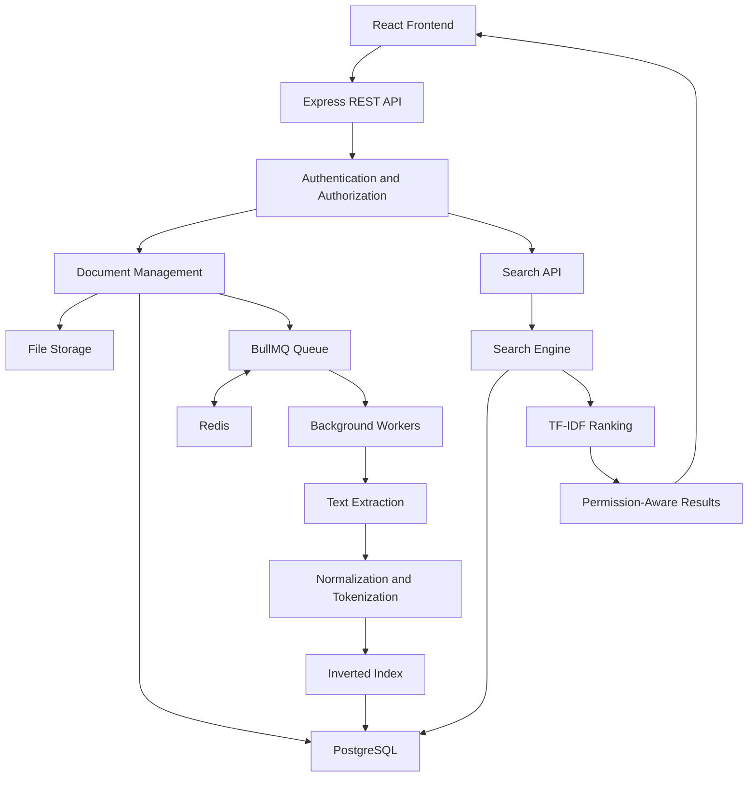

# SearchForge Enterprise

### Permission-Aware Internal Technical Document Search Engine

[]()
[]()
[]()
[]()
[]()

**SearchForge Enterprise** is an engineering project focused on building a permission-aware internal document search platform that helps software engineering teams find relevant technical information across their organization's uploaded documents.

The project explores how search engines work internally, including document processing, text extraction, tokenization, inverted indexing, relevance ranking, asynchronous processing, multi-tenant architecture, and secure document retrieval.

> The goal is not simply to build a search interface. The goal is to understand, design, and implement the engineering systems behind a scalable document search platform.

---

## 1. The Problem

Software organizations generate and maintain large amounts of internal technical documentation:

- API documentation
- Engineering documentation
- Troubleshooting guides
- Incident reports
- Architecture Decision Records (ADRs)
- Technical knowledge documents

Consider an engineer investigating a PostgreSQL connection timeout.

They know that their team encountered a similar issue previously, but they don't know which document contains the solution.

They may have to search through folders, open multiple files, and manually inspect their contents.

This creates a knowledge retrieval problem.

**SearchForge aims to solve this problem by providing a centralized search system for internal technical documents.**

## 2. Our Solution

SearchForge allows authorized employees to upload technical documents and search their contents using keywords.

Instead of scanning every document whenever someone searches, SearchForge prepares documents in advance using an indexing process.

The initial search engine will use:

- Text extraction
- Text normalization
- Tokenization
- Inverted indexing
- TF-IDF relevance ranking
- Search result snippets

### Example

Suppose an organization has these documents:

| Document | Content |
|---|---|
| D1 | Node.js backend development |
| D2 | Java backend development |
| D3 | Node.js database optimization |

The search engine builds an inverted index:

| Term | Documents |
|---|---|
| nodejs | D1, D3 |
| backend | D1, D2 |
| development | D1, D2 |
| java | D2 |
| database | D3 |
| optimization | D3 |

When an employee searches for `Node.js`, the engine can retrieve D1 and D3 directly from the index.

This is the fundamental idea behind SearchForge's initial retrieval engine.

---

## 3. How SearchForge Works

SearchForge has two primary workflows.

### A. Document Indexing

Indexing prepares uploaded documents for efficient searching.

1. Employee uploads a document.
2. Backend validates the request and permissions.
3. Original document is stored.
4. Document metadata is saved in PostgreSQL.
5. A background processing job is created.
6. A worker extracts text from the document.
7. Extracted text is normalized and tokenized.
8. The search engine builds an inverted index.
9. Index entries are stored in PostgreSQL.
10. Document status changes to `INDEXED`.

### B. Document Searching

Searching retrieves relevant documents from the prepared index.

1. Employee submits a keyword query.
2. Backend authenticates the employee.
3. Organization membership and document permissions are verified.
4. Search query is normalized and tokenized.
5. Inverted index retrieves matching documents.
6. TF-IDF calculates relevance scores.
7. Documents are ranked.
8. Authorized snippets and metadata are prepared.
9. Ranked search results are returned to the frontend.

---

## 4. System Architecture

The initial conceptual architecture:



This architecture will evolve as the project progresses and engineering requirements become clearer.

### Major Components

| Component | Responsibility |
|---|---|
| React Frontend | Document uploads, search interface, result presentation |
| Node.js | Backend JavaScript runtime |
| Express.js | REST API and request handling |
| PostgreSQL | Persistent application data and search index storage |
| Prisma ORM | Database access and schema management |
| Redis | Background queue infrastructure |
| BullMQ | Job scheduling, retries and job management |
| Background Workers | Asynchronous document processing |
| Search Engine | Index lookup and relevance ranking |

---

## 5. Technology Stack

| Layer | Technology |
|---|---|
| Frontend | React + Vite |
| Styling | Tailwind CSS |
| Backend | Node.js + Express.js |
| Language | JavaScript |
| Database | PostgreSQL |
| ORM | Prisma |
| Queue | BullMQ |
| In-memory infrastructure | Redis |
| Document Processing | PDF and DOCX text extraction libraries |
| Testing | Jest + Supertest |
| Containerization | Docker |
| Version Control | Git + GitHub |

Technologies will be introduced and evaluated as their engineering purpose becomes relevant.

---

## 6. Core Engineering Concepts

SearchForge is also a deep-learning and engineering research project.

### Information Retrieval

- Information retrieval fundamentals
- Keyword-based search
- Inverted index
- Posting lists
- Term frequency
- Document frequency
- TF-IDF
- Relevance ranking
- Search result snippets
- Tokenization and normalization

### Backend Engineering

- Node.js internals
- Express middleware
- REST API design
- Authentication and authorization
- Modular backend architecture
- Database transactions
- Error handling

### Distributed and Asynchronous Processing

- Redis fundamentals
- Message queues
- BullMQ
- Background workers
- Concurrent processing
- Retry mechanisms
- Idempotency
- Dead-letter handling
- Failure recovery

### Database Engineering

- Relational database design
- PostgreSQL indexes
- Query optimization
- Transactions and consistency
- Multi-tenant database architecture
- Document-term relationships

### Enterprise Security

- Multi-tenancy
- Role-based access control
- Document-level permissions
- Tenant isolation
- Secure file handling
- Audit logging

### Performance Engineering

- Search complexity
- Index storage overhead
- Query latency
- Worker throughput
- Concurrent uploads
- Benchmarking
- Scalability experiments

---

## 7. Project Scope

The initial version will focus on a deliberately narrow problem.

| Area | Initial Scope |
|---|---|
| Target users | Software engineering teams |
| Document sources | Manual uploads |
| Supported formats | PDF, DOCX, TXT |
| Search experience | Keyword-based search |
| Retrieval | Custom inverted index |
| Ranking | TF-IDF |
| Processing | Asynchronous background workers |
| Security | Organization and document-level authorization |

### Future Possibilities

Features to investigate after the initial search system works:

- Semantic search
- Hybrid search
- Phrase and proximity search
- Document versioning
- External storage integrations
- Advanced analytics
- More sophisticated relevance ranking

These are future research directions, not current MVP commitments.

---

## 8. Development Roadmap

Development will proceed incrementally.

- [ ] Product research and problem validation
- [ ] Functional and non-functional requirements
- [ ] Client-server architecture
- [ ] System architecture and data flow
- [ ] Database design and ER diagram
- [ ] Authentication and organization management
- [ ] Document upload and storage
- [ ] Text extraction
- [ ] Text normalization and tokenization
- [ ] Inverted index implementation
- [ ] TF-IDF ranking
- [ ] Search API
- [ ] Redis and BullMQ integration
- [ ] Background processing workers
- [ ] Retry and failure recovery
- [ ] Multi-tenant security
- [ ] Document-level access control
- [ ] Frontend search experience
- [ ] Testing and benchmarking
- [ ] Dockerization and deployment

Progress will be updated as each component is researched, implemented, and tested.

---

## 9. Research-First Development Approach

This repository contains both the implementation and the engineering research behind SearchForge.

Every important topic will follow this process:

1. Understand the problem.
2. Study the underlying concept.
3. Research internal working and alternatives.
4. Analyze architectural decisions and trade-offs.
5. Document findings.
6. Implement a small experiment or feature.
7. Test and evaluate the implementation.
8. Commit and push the completed work.

The objective is to understand not only **how** something works, but also **why** it is needed and **when** an alternative might be better.

### Repository Structure

```text
SearchForge/
│
├── README.md
│
├── research/
│   ├── 01-product-foundations/
│   ├── 02-system-architecture/
│   ├── 03-backend-fundamentals/
│   ├── 04-database-design/
│   ├── 05-document-processing/
│   ├── 06-search-engine/
│   ├── 07-background-processing/
│   ├── 08-reliability/
│   ├── 09-security/
│   └── 10-performance/
│
├── docs/
│   ├── architecture/
│   ├── diagrams/
│   └── decisions/
│
├── backend/
├── frontend/
├── tests/
└── benchmarks/
```

---

## 10. Engineering Goals

By completing this project, the intended learning outcomes are:

- Understand how a keyword search engine works internally.
- Implement an inverted index from scratch.
- Understand relevance ranking using TF-IDF.
- Design asynchronous document processing.
- Build reliable background workers.
- Design a multi-tenant backend.
- Implement secure document retrieval.
- Measure and analyze system performance.
- Explain architecture and engineering trade-offs confidently.

---

## 11. Project Status

**Current phase: Research and architectural understanding.**

The project is being developed incrementally, beginning with product foundations and system architecture before moving into implementation.

Features described in this README are planned unless explicitly documented as implemented.

---

## Repository

**GitHub:** https://github.com/786-JIYA/SearchForge

---

*SearchForge Enterprise — Understand the problem. Research the system. Build the engine. Measure the results.*
