# SearchForge

### Engineering Knowledge Retrieval & Answer Generation Platform

[]()
[]()
[]()
[]()
[]()

**SearchForge** is an engineering knowledge retrieval platform designed to help software engineering teams discover, understand, and reuse technical knowledge stored across their organization's internal documents.

It focuses on retrieving information from:

- Incident reports and Root Cause Analyses (RCAs)
- Troubleshooting guides
- API documentation
- Engineering documentation
- Architecture Decision Records (ADRs)
- Technical solutions and operational knowledge

SearchForge combines a custom information retrieval engine, permission-aware document access, source traceability, document freshness, reliable asynchronous indexing, and evidence-grounded answer generation.

> **Find the knowledge. Understand the solution. Verify the source. Reuse it confidently.**

The goal is not simply to build an AI chatbot or a search interface. The goal is to understand, design, implement, and evaluate the engineering systems behind a reliable knowledge retrieval platform.

---

## 1. The Problem

Software engineering teams continuously generate valuable technical knowledge.

For example:

- An engineer investigates a production incident.
- Another engineer discovers the root cause.
- A team documents the resolution.
- An architect records why a particular technology was selected.
- A developer writes API usage and troubleshooting documentation.

Over time, organizations accumulate hundreds or thousands of technical documents.

However, storing knowledge does not guarantee that engineers can find or reuse it.

### Example: A PostgreSQL Connection Timeout

Imagine a developer investigating this error:

`PostgreSQL connection timeout`

The developer wants to know:

1. Has this issue happened before?
2. What caused it?
3. How was it resolved?
4. Is there an existing troubleshooting guide?
5. Why was the current connection-pooling architecture selected?
6. Is the documented solution still relevant?

The information may already exist in an incident report, a troubleshooting guide, and an architecture decision document.

But the developer might need to search through folders, open several files, read lengthy documents, and manually connect the information.

This creates an **engineering knowledge retrieval problem**.

### The Core Problem

Organizations generate valuable technical knowledge, but engineers often struggle to:

- Discover relevant historical solutions.
- Connect information across multiple documents.
- Understand the context behind previous engineering decisions.
- Verify where an answer came from.
- Determine whether information is outdated.
- Access only the information they are authorized to see.

**SearchForge aims to reduce this knowledge discovery effort.**

---

## 2. Our Solution

SearchForge provides a centralized, permission-aware platform where authorized engineers can upload technical documents, retrieve relevant information, and obtain understandable answers grounded in those documents.

Instead of scanning every document during every search, SearchForge processes and indexes documents in advance.

When an engineer asks a question, the system:

1. Understands the searchable keywords in the query.
2. Identifies relevant indexed passages.
3. Applies document permissions.
4. Ranks authorized results.
5. Retrieves supporting evidence.
6. Generates an answer using the retrieved evidence.
7. Displays references to the original documents.

### Two Important Capabilities

**A. Knowledge Retrieval**

Find relevant documents and passages using a custom retrieval engine.

Initial retrieval techniques:

- Text extraction
- Text normalization
- Tokenization
- Inverted indexing
- TF-IDF relevance ranking
- Passage retrieval
- Search result snippets

**B. Evidence-Grounded Answer Generation**

Generate understandable answers from retrieved internal technical documents.

The answer generation system should:

- Use retrieved evidence rather than inventing company-specific information.
- Attach references to supporting documents and passages.
- Indicate when available documentation is insufficient.
- Identify conflicting information instead of silently choosing an answer.
- Respect document permissions.

### Example

Suppose an organization contains these documents:

| Document | Content |
|---|---|
| D1 | Incident report: PostgreSQL connection pool reached maximum capacity |
| D2 | Troubleshooting guide: inspect active connections and long-running queries |
| D3 | Architecture decision: why connection pooling was introduced |

An engineer asks:

**"Why are we getting PostgreSQL connection timeouts, and what should we investigate?"**

SearchForge retrieves relevant passages from D1 and D2.

It can generate an answer explaining:

- The previously documented connection-pool capacity issue.
- The troubleshooting steps recommended in the guide.
- The relevant supporting sources.

The answer should not claim that the current incident has the same root cause unless the retrieved evidence supports that conclusion.

---

## 3. How SearchForge Works

SearchForge has two primary workflows.

### A. Document Ingestion and Indexing

Indexing prepares uploaded documents for efficient retrieval.

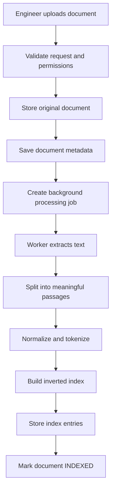

The processing steps:

1. Engineer uploads a document.
2. Backend validates the file and request permissions.
3. Original document is stored.
4. Document metadata is saved in PostgreSQL.
5. A background processing job is created.
6. A worker extracts text.
7. Extracted text is divided into meaningful passages.
8. Text is normalized and tokenized.
9. The search engine builds an inverted index.
10. Index entries and passage references are stored.
11. Document status changes to `INDEXED`.

A document should become searchable only after its index has been successfully prepared.

### B. Knowledge Retrieval and Answer Generation

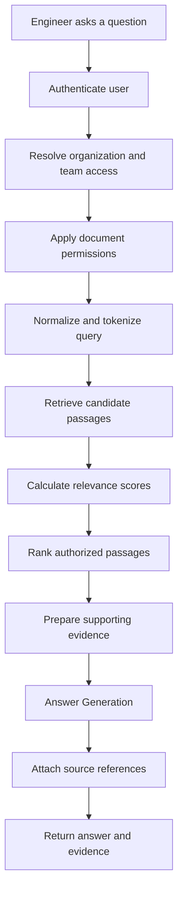

The retrieval and answer generation process:

1. Engineer submits a question.
2. Backend authenticates the engineer.
3. Organization and team memberships are resolved.
4. Document-level permissions are applied.
5. Query is normalized and tokenized.
6. Inverted index retrieves matching passages.
7. TF-IDF calculates relevance scores.
8. Relevant passages are ranked.
9. Supporting evidence is prepared.
10. The answer generator receives authorized evidence.
11. An understandable answer is generated.
12. Source references and freshness information are returned.

**Important:** Permission filtering must happen before unauthorized passages, snippets, or metadata are exposed to the user or sent to the LLM.

---

## 4. System Architecture

The initial conceptual architecture:

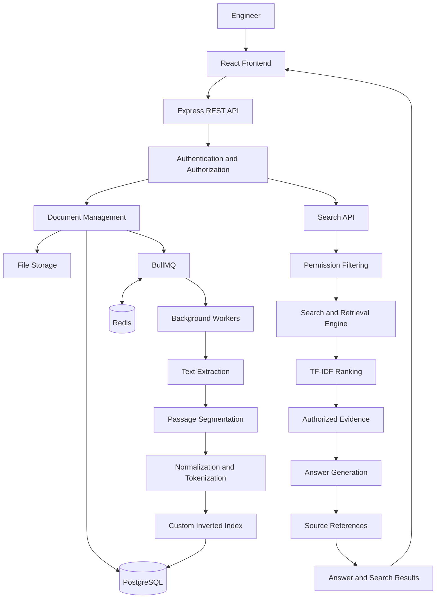

### Major Components

| Component | Responsibility |
|---|---|
| React Frontend | Upload documents, submit questions, display answers and references |
| Node.js | Backend JavaScript runtime |
| Express.js | REST API and request handling |
| PostgreSQL | Persistent application data and search index storage |
| Prisma ORM | Database access and schema management |
| Redis | Background queue infrastructure |
| BullMQ | Job scheduling, retries and job management |
| Background Workers | Asynchronous document processing |
| Document Processor | Text extraction and passage segmentation |
| Search Engine | Inverted index lookup and retrieval |
| Ranking Engine | Relevance scoring using TF-IDF |
| Authorization Layer | Organization, team and document permissions |
| Answer Generator | Generates answers from retrieved evidence |
| Source Reference Layer | Connects answers to original documents and passages |

This architecture is conceptual and will evolve as implementation and engineering requirements become clearer.

---

## 5. The Retrieval Engine

The retrieval engine is one of the most important engineering components of SearchForge.

The initial implementation will focus on keyword-based information retrieval.

### What Is an Inverted Index?

An inverted index maps a term to the documents or passages containing that term.

Consider three documents:

| Document | Content |
|---|---|
| D1 | Node.js backend development |
| D2 | Java backend development |
| D3 | Node.js database optimization |

The search engine builds:

| Term | Documents |
|---|---|
| nodejs | D1, D3 |
| backend | D1, D2 |
| development | D1, D2 |
| java | D2 |
| database | D3 |
| optimization | D3 |

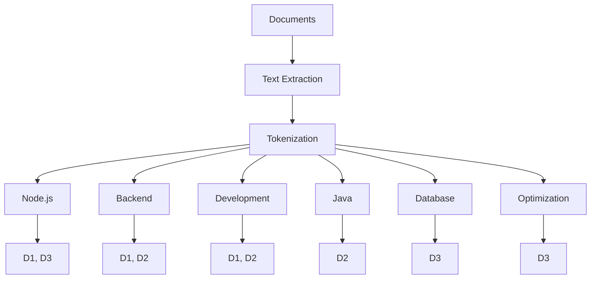

When an engineer searches for `Node.js`, the search engine can retrieve D1 and D3 from the index without scanning the full contents of every document.

### Relevance Ranking

Finding matching documents is not enough. SearchForge must determine which results are more relevant.

The initial ranking algorithm will use TF-IDF.

**Term Frequency (TF):**

Measures how frequently a term appears in a document or passage.

\[
TF(t,d)=\frac{\text{Count of term }t\text{ in }d}{\text{Total terms in }d}
\]

**Inverse Document Frequency (IDF):**

Measures how rare a term is across the indexed document collection.

\[
IDF(t)=\log\left(\frac{N}{DF(t)}\right)
\]

Where:

- \(N\) = Total number of indexed documents.
- \(DF(t)\) = Number of documents containing term \(t\).

**TF-IDF:**

\[
TFIDF(t,d)=TF(t,d)\times IDF(t)
\]

TF-IDF will provide the initial relevance-ranking baseline. It does not understand the semantic meaning of a question, so its limitations will be measured before considering more advanced retrieval methods.

---

## 6. Source Traceability and Evidence

A generated answer should not be treated as trustworthy merely because it sounds convincing.

SearchForge must allow engineers to inspect the information supporting an answer.

### Conceptual Answer Structure

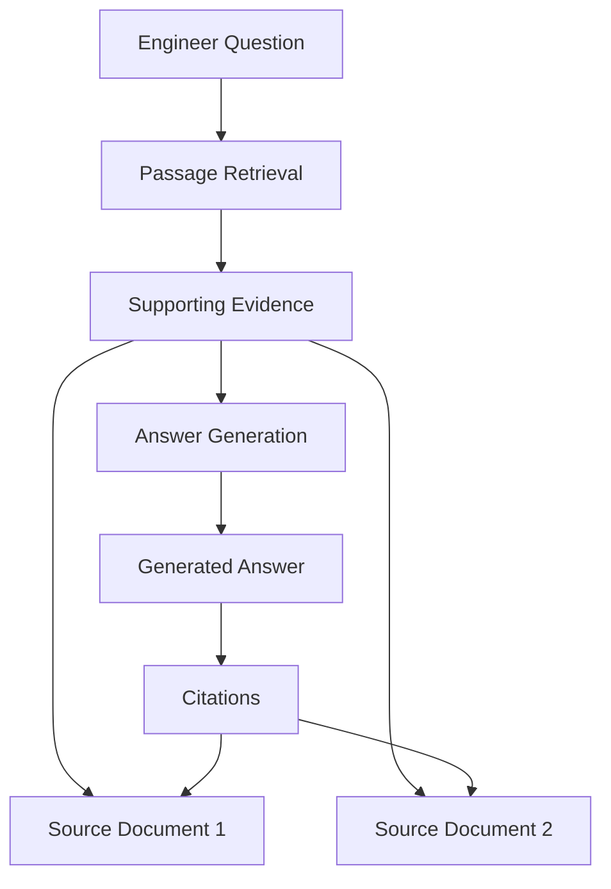

A source reference may contain:

- Document title
- Document identifier
- Relevant passage
- Section or heading
- Page number, when available
- Document version
- Last updated timestamp

The exact reference format will be finalized during implementation.

### Evidence Handling Rules

SearchForge should follow these rules:

1. Every supported answer should link to its supporting source.
2. A source reference should point to the actual retrieved passage.
3. Unsupported claims should not be presented as established company facts.
4. Insufficient evidence should result in an explicit limitation.
5. Conflicting documents should be identified rather than silently reconciled.

The goal is to make answers verifiable, not merely readable.

---

## 7. Answer Generation: Phase A and Phase B

Answer generation will be introduced in two phases.

### Phase A — Internal Knowledge Only

<badge>Initial answer-generation phase</badge>

The LLM receives only authorized passages retrieved from the organization's internal documents.

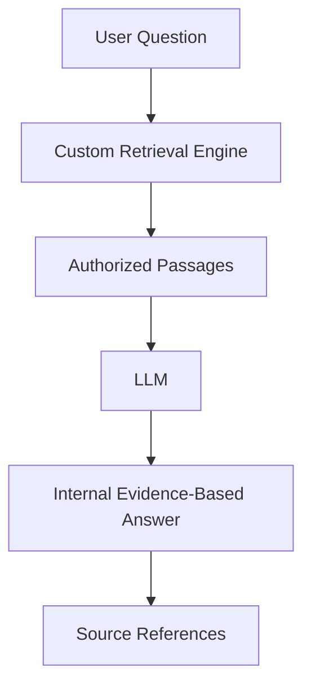

Expected behavior:

- Use internal documents as evidence.
- Cite supporting passages.
- Identify insufficient evidence.
- Identify conflicting documentation.
- Avoid unsupported company-specific claims.

If the available documents do not contain an answer, SearchForge should say so.

### Phase B — Internal Knowledge + General Technical Knowledge

<badge color="info">Future extension</badge>

After Phase A is working reliably, SearchForge can be extended to include general technical knowledge.

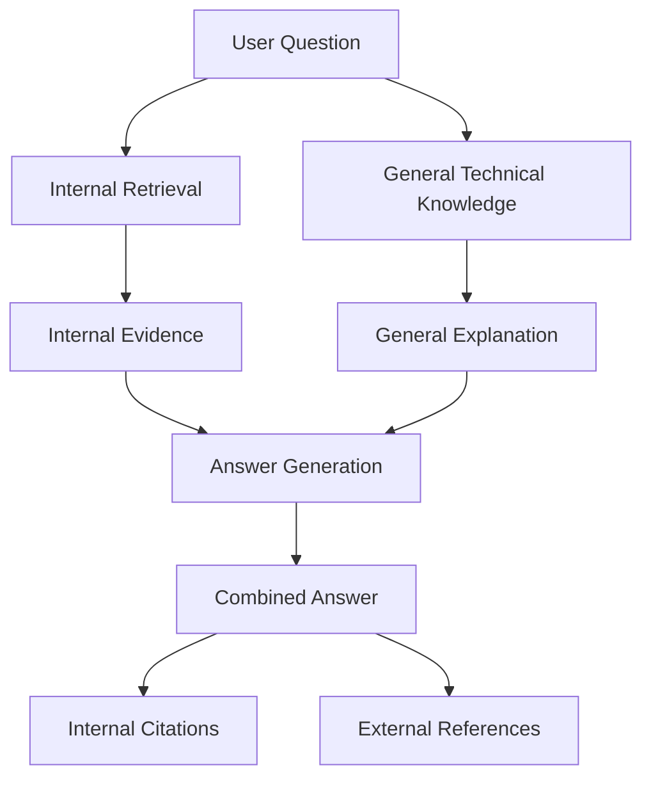

The answer must distinguish:

- **Internal evidence:** Information documented and retrieved from the organization.
- **General technical knowledge:** External or general explanations that are not necessarily approved organizational decisions.

General recommendations must never be presented as official company policies or decisions.

**Architectural decision:** Retrieval and answer generation will remain separate modules so that the custom retrieval engine continues to work even when an LLM provider is unavailable.

---

## 8. Permissions and Multi-Tenant Security

SearchForge is intended for organizations that may contain multiple teams and different access levels.

Not every employee should be able to retrieve every document.

### Initial Permission Model

| Visibility | Access |
|---|---|
| PRIVATE | Document owner |
| TEAM | Authorized members of the selected team |
| ORGANIZATION | Authorized members of the organization |

### Permission-Aware Retrieval

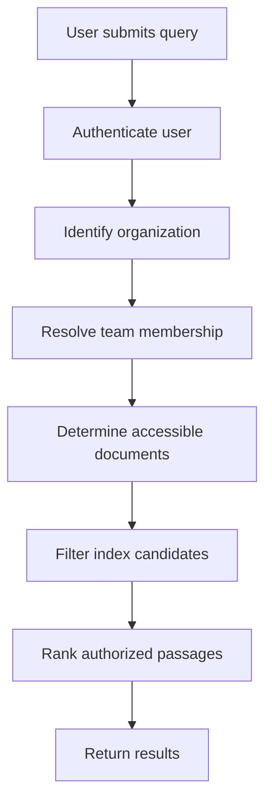

Permission checks must happen on the backend.

The frontend must not be responsible for hiding unauthorized documents after they have already been returned by the API.

### Security Requirements

- Organization isolation.
- Team-level authorization.
- Private document protection.
- Secure file access.
- Permission-aware search snippets.
- No unauthorized source references.
- Server-side access validation.

An unauthorized document must not leak through its title, metadata, snippets, or generated answers when the user lacks permission to access it.

---

## 9. Document Freshness and Versioning

Engineering knowledge changes over time.

A troubleshooting guide written two years ago may no longer describe the current architecture.

SearchForge should therefore track document freshness.

### Document Metadata

Potential metadata includes:

- Document creation time
- Last updated time
- Document version
- Document owner
- Indexing status
- Last successful indexing time
- Superseded or outdated status

### Document Update Workflow

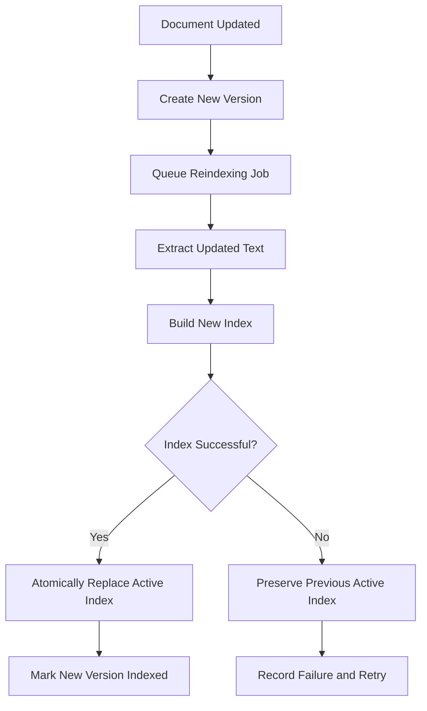

The previous valid index should not be partially overwritten by an unsuccessful indexing attempt.

Freshness information should help engineers understand when a source was last updated and whether it has been superseded.

---

## 10. Asynchronous Processing and Reliability

Document extraction and indexing can be expensive operations.

They should not block the upload API request.

SearchForge will use Redis and BullMQ for background processing.

### Why Background Workers?

Without background processing:

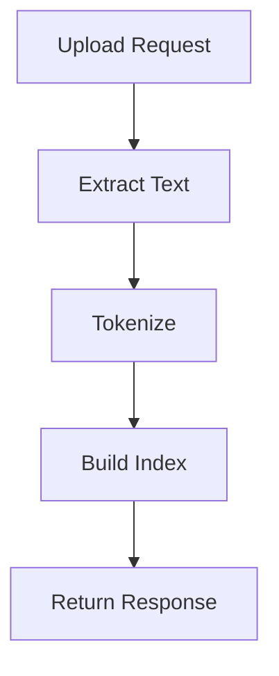

The upload request may remain open until all processing is complete.

With background processing:

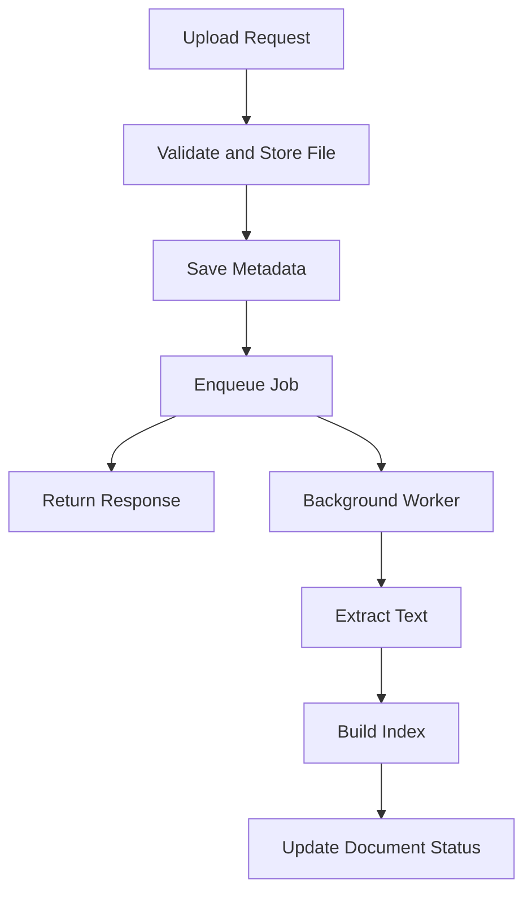

The API can respond after successfully storing the file and queueing the processing job.

The worker performs the expensive operations independently.

### Reliability Requirements

SearchForge will investigate and implement:

- Job retries.
- Retry backoff.
- Idempotent processing.
- Duplicate job prevention.
- Failure tracking.
- Dead-letter handling.
- Worker recovery.
- Index consistency.
- Atomic index replacement.

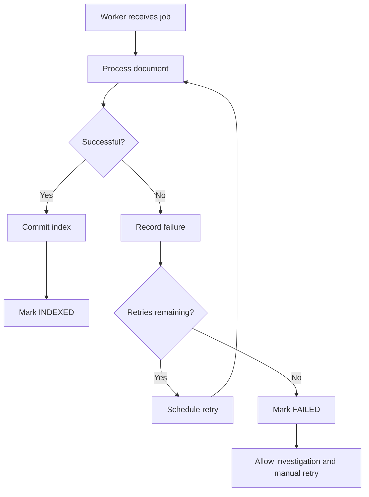

PostgreSQL will remain the persistent source of truth. Redis will coordinate background jobs rather than act as permanent document storage.

---

## 11. Technology Stack

| Layer | Technology |
|---|---|
| Frontend | React + Vite |
| Styling | Tailwind CSS |
| Backend | Node.js + Express.js |
| Language | JavaScript |
| Database | PostgreSQL |
| ORM | Prisma |
| Queue | BullMQ |
| Queue Infrastructure | Redis |
| Search | Custom Inverted Index |
| Ranking | TF-IDF |
| Document Processing | PDF and DOCX text extraction libraries |
| Answer Generation | LLM API |
| Testing | Jest + Supertest |
| Containerization | Docker |
| Version Control | Git + GitHub |

Technologies will be introduced and evaluated when their engineering purpose becomes relevant.

The initial LLM provider and document storage provider remain implementation decisions to be evaluated.

---

## 12. Core Engineering Concepts

SearchForge is also a research-first engineering project.

### Information Retrieval

- Information retrieval fundamentals
- Keyword-based search
- Inverted indexes
- Posting lists
- Term frequency
- Document frequency
- TF-IDF
- Relevance ranking
- Passage retrieval
- Search result snippets
- Tokenization and normalization

### Document Processing

- File validation
- PDF and DOCX text extraction
- Text normalization
- Passage segmentation
- Metadata extraction
- Document versioning
- Reindexing

### Backend Engineering

- Node.js internals
- Express middleware
- REST API design
- Authentication and authorization
- Modular backend architecture
- Database transactions
- Error handling

### Distributed and Asynchronous Processing

- Redis fundamentals
- Message queues
- BullMQ
- Background workers
- Concurrent processing
- Retry mechanisms
- Idempotency
- Dead-letter handling
- Failure recovery

### Database Engineering

- Relational database design
- PostgreSQL indexes
- Query optimization
- Transactions and consistency
- Multi-tenant database architecture
- Document-passage-term relationships
- Index storage and retrieval

### Enterprise Security

- Multi-tenancy
- Role-based access control
- Document-level permissions
- Tenant isolation
- Secure file handling
- Audit logging
- Permission-aware retrieval

### AI and Answer Generation

- Retrieval-Augmented Generation (RAG)
- Context construction
- Evidence-grounded generation
- Citation generation
- Insufficient evidence handling
- Conflicting evidence
- Hallucination evaluation
- Separation of retrieval and generation

### Performance Engineering

- Search complexity
- Index storage overhead
- Query latency
- Worker throughput
- Concurrent uploads
- Benchmarking
- Scalability experiments
- Retrieval evaluation

---

## 13. Project Scope

The initial version will focus on a deliberately narrow problem.

| Area | Initial Scope |
|---|---|
| Target users | Software engineering teams |
| Document sources | Manual uploads |
| Supported formats | PDF, DOCX, TXT, MD (to be finalized) |
| Search experience | Keyword-based retrieval |
| Retrieval | Custom inverted index |
| Ranking | TF-IDF |
| Retrieval unit | Document passages |
| Processing | Asynchronous background workers |
| Security | Organization and document-level authorization |
| Freshness | Basic timestamps and version tracking |
| Answer generation | Internal-document-only RAG |
| Source traceability | Document and passage references |

### Future Possibilities

Features to investigate after the initial system works:

- Semantic search.
- Hybrid search.
- Phrase and proximity search.
- Advanced reranking.
- External document integrations.
- Advanced document version management.
- Search analytics.
- General technical knowledge in answer generation.
- More sophisticated relevance ranking.

These are future research directions, not current MVP commitments.

### Initial Out of Scope

- Automatic crawling of external platforms.
- Slack, GitHub, and Confluence integrations.
- OCR for scanned documents.
- Cross-organization search.
- Complex enterprise administration.
- Advanced vector search.
- General-knowledge answer generation in Phase A.

---

## 14. Evaluation and Success Metrics

SearchForge should be evaluated through measurable engineering results rather than feature count alone.

### Retrieval Quality

- Precision@K
- Recall@K
- Mean Reciprocal Rank (MRR)
- Passage relevance

### Answer Quality

- Factual support.
- Citation correctness.
- Citation completeness.
- Unsupported claim rate.
- Correct handling of insufficient evidence.
- Correct handling of conflicting documents.

### Performance

- Search latency.
- p95 query latency.
- Indexing throughput.
- Index storage overhead.
- Worker processing time.

### Reliability

- Job failure rate.
- Retry success rate.
- Duplicate processing prevention.
- Worker recovery.
- Index consistency.

### Security

- Organization isolation.
- Team-level access enforcement.
- Private document protection.
- No unauthorized snippets or source references.

Numeric targets will be established after baseline experiments.

---

## 15. Development Roadmap

Development will proceed incrementally.

### Phase 1 — Product Foundations

- [ ] Product definition.
- [ ] Problem and use-case analysis.
- [ ] Functional requirements.
- [ ] Non-functional requirements.
- [ ] User workflows.
- [ ] Product validation.

### Phase 2 — System Architecture

- [ ] Client-server architecture.
- [ ] System architecture and data flow.
- [ ] Database design and ER diagram.
- [ ] Permission model.
- [ ] Document lifecycle.
- [ ] API design.

### Phase 3 — Backend Foundations

- [ ] Backend project setup.
- [ ] Authentication.
- [ ] Organization management.
- [ ] Team membership.
- [ ] Document metadata management.
- [ ] File upload and storage.

### Phase 4 — Document Processing

- [ ] Text extraction.
- [ ] Passage segmentation.
- [ ] Text normalization.
- [ ] Tokenization.
- [ ] Document state management.
- [ ] Background job integration.

### Phase 5 — Custom Search Engine

- [ ] Inverted index implementation.
- [ ] Posting lists.
- [ ] Term frequency.
- [ ] Document frequency.
- [ ] TF-IDF ranking.
- [ ] Search API.
- [ ] Search result snippets.
- [ ] Retrieval benchmarks.

### Phase 6 — Security and Reliability

- [ ] Organization isolation.
- [ ] Document-level authorization.
- [ ] Permission-aware retrieval.
- [ ] Retry and failure recovery.
- [ ] Idempotent indexing.
- [ ] Atomic index replacement.
- [ ] Document freshness and versioning.

### Phase 7 — Answer Generation (Phase A)

- [ ] Retrieval-Augmented Generation architecture.
- [ ] Context construction.
- [ ] LLM integration.
- [ ] Evidence-grounded answers.
- [ ] Source references.
- [ ] Insufficient evidence handling.
- [ ] Conflicting evidence handling.
- [ ] Answer evaluation.

### Phase 8 — Frontend and Integration

- [ ] Document management interface.
- [ ] Search interface.
- [ ] Answer presentation.
- [ ] Source inspection.
- [ ] Freshness indicators.
- [ ] Permission-aware UI.
- [ ] End-to-end integration.

### Phase 9 — Testing and Deployment

- [ ] Unit tests.
- [ ] API integration tests.
- [ ] Security tests.
- [ ] Retrieval evaluation.
- [ ] Answer quality evaluation.
- [ ] Performance benchmarks.
- [ ] Dockerization.
- [ ] Deployment.

### Future Phase — General Technical Knowledge (Phase B)

- [ ] Evaluate general knowledge sources.
- [ ] Separate internal and external evidence.
- [ ] Introduce external citations.
- [ ] Evaluate answer reliability.

---

## 16. Research-First Development Approach

This repository contains both the implementation and the engineering research behind SearchForge.

Every important topic will follow this process:

1. Understand the problem.
2. Study the underlying concept.
3. Research internal working and alternatives.
4. Analyze architectural decisions and trade-offs.
5. Document findings.
6. Implement a small experiment or feature.
7. Test and evaluate the implementation.
8. Commit and push the completed work.

The objective is to understand not only **how** something works, but also **why** it is needed and **when** an alternative might be better.

### Repository Structure

```text
SearchForge/
│
├── README.md
│
├── research/
│   ├── 01-product-foundations/
│   ├── 02-system-architecture/
│   ├── 03-backend-fundamentals/
│   ├── 04-database-design/
│   ├── 05-document-processing/
│   ├── 06-search-engine/
│   ├── 07-background-processing/
│   ├── 08-reliability/
│   ├── 09-security/
│   ├── 10-answer-generation/
│   └── 11-performance/
│
├── docs/
│   ├── architecture/
│   ├── diagrams/
│   └── decisions/
│
├── backend/
├── frontend/
├── tests/
└── benchmarks/
```

---

## 17. Engineering Goals

By completing this project, the intended learning outcomes are:

- Understand how a keyword search engine works internally.
- Implement a custom inverted index.
- Understand relevance ranking using TF-IDF.
- Design passage-based retrieval.
- Build reliable asynchronous document processing.
- Design a multi-tenant backend.
- Implement secure document retrieval.
- Understand Retrieval-Augmented Generation.
- Build evidence-grounded answer generation.
- Implement source traceability.
- Handle outdated and conflicting documentation.
- Measure and analyze system performance.
- Explain architecture and engineering trade-offs confidently.

---

## 18. Project Status

**Current phase: Research and architectural understanding.**

The project is being developed incrementally, beginning with product foundations and system architecture before moving into implementation.

The features described in this README represent the intended product scope. They should not be considered implemented unless explicitly documented and verified.

---

## Repository

**GitHub:** https://github.com/786-JIYA/SearchForge

---

*SearchForge — Find the knowledge. Understand the solution. Verify the source. Reuse it confidently.*
