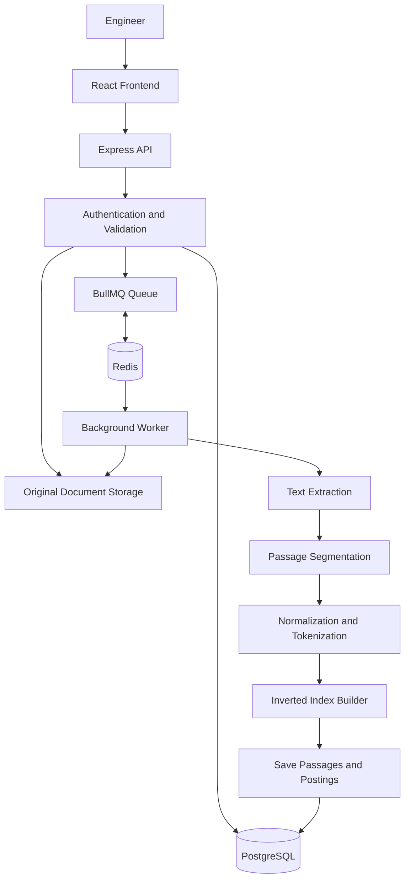
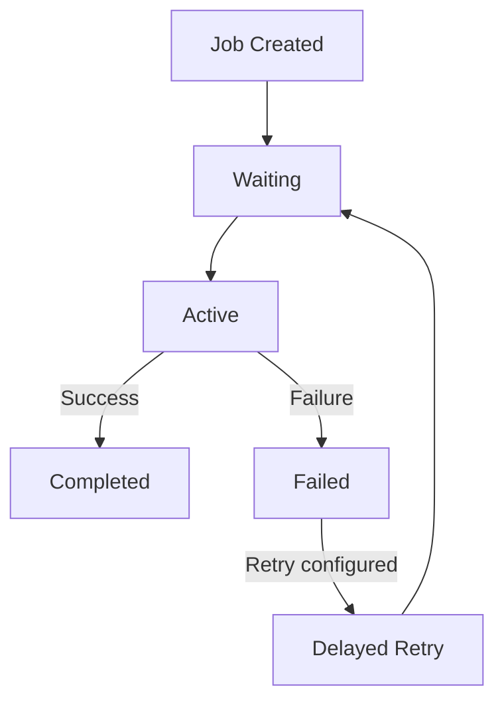
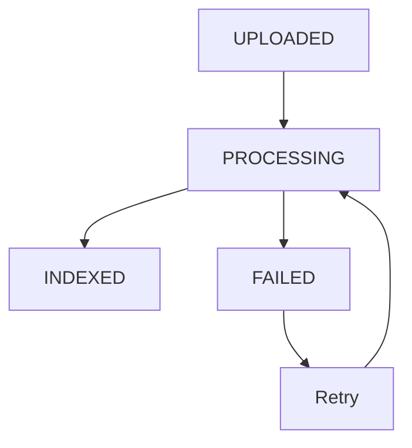

# Background Workers, Redis and BullMQ

**Project:** SearchForge — Engineering Knowledge Retrieval & Answer Generation Platform  
**Research Area:** System Architecture  
**Topic:** Background Processing and Job Queues  
**Status:** Research and Understanding

---

# 1. Introduction

SearchForge allows engineering teams to upload technical documents such as:

- Incident investigation reports.
- Troubleshooting guides.
- API documentation.
- Architecture Decision Records (ADRs).
- Deployment documentation.

However, uploading a document is only the beginning.

Before a document becomes searchable, SearchForge must perform several processing operations:

1. Extract text from the original file.
2. Divide extracted text into smaller passages.
3. Normalize the text.
4. Tokenize the content.
5. Build an inverted index.
6. Save passages and index information.
7. Update the document's processing status.

These operations can take time, especially when documents are large or multiple documents are uploaded simultaneously.

**The problem:** Should the user wait for all these operations to finish before receiving a response?

No.

SearchForge should accept the upload, acknowledge the request and perform document processing independently in the background.

This is called **background processing**.

# 2. What is background processing?

Background processing means executing a task independently of the immediate user request.

The user does not need to wait for the entire task to finish.

For example:

A developer uploads `PostgreSQL-Incident-104.pdf`.

The backend:

1. Receives the file.
2. Validates it.
3. Stores the original file.
4. Saves document metadata.
5. Creates an indexing job.
6. Returns an upload confirmation.

Meanwhile, a background worker processes the document.

The user can continue using SearchForge while indexing happens.

## 2.1 Real-world analogy

Imagine a restaurant.

- Customer places an order.
- Reception accepts the order.
- The kitchen prepares the food.
- The customer does not stand inside the kitchen waiting.
- The customer receives the food when it is ready.

In this analogy:

| Restaurant | SearchForge |
|---|---|
| Customer | Engineer |
| Reception | Express API |
| Order | Background job |
| Order queue | Job queue |
| Kitchen staff | Background worker |
| Preparing food | Document processing |
| Order ready | Document indexed |

The API accepts the task, while the worker performs it.

# 3. Synchronous vs asynchronous processing

Before understanding Redis and BullMQ, we must understand two processing approaches.

## 3.1 Synchronous processing

Synchronous processing means the current operation waits for the previous operation to complete.

For SearchForge:

```text
User uploads PDF
       |
       v
Express receives request
       |
       v
Extract text
       |
       v
Create passages
       |
       v
Tokenize content
       |
       v
Build inverted index
       |
       v
Save index
       |
       v
Send response to user
```

The API response is delayed until processing finishes.

### Problems

- Large files may take considerable time.
- HTTP requests may time out.
- The API process remains occupied with the task.
- Many simultaneous uploads can increase server load.
- The user must wait for processing to finish.

Synchronous processing is not always wrong. Small, quick operations are often best performed synchronously.

The problem is using it for long-running work that does not need to block the user's request.

## 3.2 Asynchronous processing

Asynchronous processing allows the API to initiate a task and return a response while the task continues separately.

For SearchForge:

```text
             USER
               |
               v
          React Frontend
               |
               v
          Express API
               |
         Validate upload
               |
               v
       Store original document
               |
               v
        Save metadata in DB
               |
               v
       Add indexing job to queue
               |
               +--------------------+
               |                    |
               v                    v
       Return response       Background Worker
       to the user                   |
                                     v
                                Extract text
                                     |
                                     v
                              Create passages
                                     |
                                     v
                                Build index
                                     |
                                     v
                               Save results
                                     |
                                     v
                              Mark INDEXED
```

The user receives a response without waiting for indexing to finish.

For example:

```json
{
  "message": "Document uploaded successfully",
  "documentId": "doc_104",
  "status": "PROCESSING"
}
```

The document is accepted, but it is not searchable yet.

It becomes searchable only after successful indexing.

## 3.3 Comparison

| Synchronous | Asynchronous |
|---|---|
| Request waits for processing | Request can return before processing finishes |
| Suitable for quick operations | Suitable for long-running tasks |
| Simpler execution flow | Requires job coordination |
| Can increase request latency | Reduces request waiting time |
| Failure occurs in request flow | Background failures need tracking and recovery |

**Important:** Asynchronous does not mean the task executes faster. It means the task does not have to block the user's immediate request.

# 4. What is a job queue?

A job queue is a mechanism for storing tasks that need to be executed.

Instead of executing a lengthy task immediately, the application adds it to a queue.

A worker retrieves jobs and processes them.

Example:

```text
           JOB QUEUE
    -------------------------
    1. Index Incident-104.pdf
    2. Index API-Guide.pdf
    3. Index ADR-012.pdf
    4. Index Troubleshooting.md
    -------------------------
                |
                v
          BACKGROUND WORKER
                |
                v
          Processes each job
```

Think of a queue as a waiting line.

The worker takes jobs from that line and executes them.

## 4.1 Producer and consumer

Two important concepts are involved.

**Producer:** The component that creates and adds a job to the queue.

**Consumer:** The component that retrieves and processes a job.

In SearchForge:

- Express API acts as the producer.
- Background worker acts as the consumer.

Example:

```text
Express API
    |
    | Adds indexing job
    v
Job Queue
    |
    | Provides job to worker
    v
Background Worker
    |
    | Executes indexing
    v
Document becomes INDEXED
```

# 5. What is Redis?

Redis is an in-memory data store.

It stores and retrieves data using data structures such as:

- Strings.
- Lists.
- Hashes.
- Sets.
- Sorted sets.

Redis is commonly used for:

- Caching.
- Queue coordination.
- Session storage.
- Real-time data.
- Messaging and event-related workloads.

For SearchForge, we use Redis as the backend datastore for our BullMQ job queue.

## 5.1 Why use Redis?

Redis keeps frequently accessed data in memory, making many operations very fast.

It also provides atomic operations that help queue systems coordinate changes to job states.

For example, imagine five documents are uploaded:

```text
Redis-backed queue

Job 1: Incident-104.pdf
Job 2: API-Guide.pdf
Job 3: ADR-012.pdf
Job 4: Database-Guide.pdf
Job 5: Deployment-Report.pdf
```

Workers can retrieve available jobs and process them.

## 5.2 Does Redis store the original PDF?

No. Not in our proposed architecture.

We separate the responsibilities:

| Component | What it stores |
|---|---|
| Document storage | Original uploaded files |
| PostgreSQL | Users, document metadata, permissions, passages and indexing records |
| Redis | Queue and job coordination data |

We should avoid placing entire PDF files inside job payloads.

Instead, a job should contain a reference to the document.

Example:

```json
{
  "documentId": "doc_104",
  "documentVersionId": "version_1"
}
```

The worker uses these identifiers to retrieve the relevant document and metadata.

## 5.3 Is Redis permanent storage?

Redis is primarily an in-memory datastore, but it supports persistence mechanisms.

Two important persistence mechanisms are:

**RDB (Redis Database):**
- Creates snapshots of the dataset.
- Allows Redis to restore data from a snapshot.

**AOF (Append Only File):**
- Records write operations.
- Can replay those operations to reconstruct Redis data.

For production queue deployments, Redis persistence and memory configuration must be considered carefully.

Redis is not our primary source of truth for business records. PostgreSQL remains that source of truth.

# 6. What is BullMQ?

BullMQ is a job-queue library for Node.js.

It uses Redis by default to manage queues and background jobs.

BullMQ provides functionality such as:

- Adding jobs.
- Processing jobs.
- Managing job states.
- Retrying failed jobs.
- Delaying jobs.
- Setting job priorities.
- Controlling worker concurrency.
- Detecting stalled jobs.

In simple words:

**Redis provides the datastore, while BullMQ provides the job-management functionality.**

## 6.1 Why do we need BullMQ if Redis already exists?

Redis is a general-purpose data store.

It does not automatically understand our application-specific indexing workflow.

We need logic for:

- Creating jobs.
- Assigning jobs to workers.
- Tracking completion.
- Handling failures.
- Retrying failed work.
- Managing concurrent processing.

We could build queue management ourselves using Redis commands, but that would mean implementing and maintaining a considerable amount of coordination and failure-handling logic.

BullMQ provides these capabilities as a reusable library.

## 6.2 Relationship between Redis and BullMQ

```text
             SEARCHFORGE
                  |
          -----------------
          |               |
          v               v
      EXPRESS API     BACKGROUND WORKER
          |               |
          v               v
      BullMQ Queue     BullMQ Worker
          |               |
          +-------+-------+
                  |
                  v
                REDIS
                  |
                  v
        Queue and job data
```

The API and worker both use BullMQ to interact with the same queue.

# 7. What is a background worker?

A worker is a running program that receives jobs and executes them.

For SearchForge, the worker performs document indexing.

Its responsibilities include:

1. Receive an indexing job.
2. Retrieve the document reference.
3. Load the original document.
4. Extract text.
5. Segment the text into passages.
6. Normalize and tokenize the passages.
7. Build the inverted index.
8. Save indexing records.
9. Update the document status.

Example:

```text
        BULLMQ QUEUE
              |
              v
     INDEXING WORKER
              |
              v
       Load document
              |
              v
        Extract text
              |
              v
      Create passages
              |
              v
     Normalize content
              |
              v
          Tokenize
              |
              v
     Build inverted index
              |
              v
     Save indexing records
              |
              v
       Mark as INDEXED
```

## 7.1 Does a worker have to run inside the Express server?

No.

A worker can run:

- In the same Node.js process as the API.
- In a separate Node.js process.
- On a separate machine.
- In a separately deployed worker service.

For SearchForge, a separate worker process or service is a useful architectural choice.

Why?

Because the API and indexing workload have different responsibilities.

If indexing becomes CPU-intensive or multiple large files arrive simultaneously, we can scale workers independently without necessarily increasing the number of API instances.

# 8. Complete SearchForge architecture

Now let's connect the components.



## 8.1 Step-by-step execution

**Step 1 — Upload**

An engineer selects a PDF in React.

React sends it to the Express API using an HTTP request.

**Step 2 — Validate**

The backend checks:

- Authentication.
- Authorization.
- File type.
- File size.
- Upload permissions.

**Step 3 — Store original document**

The original PDF is stored in document storage.

**Step 4 — Save metadata**

PostgreSQL stores information such as:

- Document ID.
- Filename.
- Owner.
- Organization.
- Visibility.
- Version.
- Processing status.

The document status becomes `PROCESSING`.

**Step 5 — Create job**

The backend adds an indexing job using BullMQ.

Example:

```javascript
await indexingQueue.add(
  "index-document",
  {
    documentId: "doc_104",
    documentVersionId: "version_1"
  }
);
```

This is an illustrative example of a job payload.

**Step 6 — Worker receives job**

A running BullMQ worker receives the available job.

**Step 7 — Process document**

The worker extracts, segments, normalizes and tokenizes the document.

**Step 8 — Build index**

The custom indexing logic creates an inverted index.

**Step 9 — Save results**

Passages, terms and postings are saved to PostgreSQL according to the database design.

**Step 10 — Update status**

After successful completion, the document status changes to:

```text
INDEXED
```

Only now should it be available to the search system.

# 9. BullMQ job lifecycle

A job does not simply move from created to completed.

It passes through different states.

Common BullMQ job states include:

| State | Meaning |
|---|---|
| Waiting | Job is waiting for a worker |
| Active | Worker is processing the job |
| Delayed | Job is scheduled to run later |
| Completed | Job finished successfully |
| Failed | Job failed |
| Waiting-children | Job is waiting for dependent child jobs |

Simplified lifecycle:



Important:

A failed job can be retried. Therefore, failure does not always mean the job is permanently finished.

# 10. What happens if a worker crashes?

This is one of the most important questions in background processing.

Imagine:

1. Worker receives `Incident-104.pdf`.
2. Worker extracts the text.
3. Worker crashes before saving the index.
4. The job is interrupted.

What should happen?

We cannot simply assume the task completed.

BullMQ uses job locks and stalled-job detection to identify jobs whose workers stop maintaining their processing locks.

Depending on the configured stalled-job limits, BullMQ can return the job to waiting or eventually mark it failed.

This allows the job to be processed again instead of remaining active forever.

However, it introduces another important engineering requirement:

**The indexing operation must be designed to handle repeated execution safely.**

# 11. Idempotency

Idempotency means that performing the same operation multiple times produces the same intended final result as performing it once.

Why does SearchForge need it?

Suppose a worker processes the same document twice because:

- The worker crashes after writing data but before acknowledging completion.
- A job is retried.
- The same upload event schedules duplicate jobs.

We must avoid creating duplicate passages and duplicate postings.

Example:

Bad behavior:

```text
First processing:
Document 104 -> 20 passages

Second processing:
Document 104 -> 40 passages
```

Desired behavior:

```text
First processing:
Document 104 -> 20 passages

Second processing:
Replace or safely reuse the same version's index.

Final result:
Document 104 -> 20 valid passages
```

Possible design:

- Associate passages with a document version.
- Use stable identifiers or unique constraints.
- Write index records transactionally where appropriate.
- Track processing state.
- Activate a completed index version safely.
- Prevent duplicate jobs when appropriate.

**Important:** BullMQ provides at-least-once delivery semantics, not an unconditional guarantee that a job's business logic executes exactly once. Our worker must therefore be idempotent.

# 12. Retry mechanisms

Sometimes jobs fail because of temporary problems.

Examples:

- Temporary database connection failure.
- Temporary document-storage outage.
- Network interruption.
- External extraction service unavailable.

Instead of immediately abandoning the job, we can configure retries.

Example:

```javascript
await indexingQueue.add(
  "index-document",
  {
    documentId: "doc_104"
  },
  {
    attempts: 3,
    backoff: {
      type: "exponential",
      delay: 1000
    }
  }
);
```

This is an illustrative configuration.

It allows up to three attempts, with exponential backoff.

## 12.1 What is exponential backoff?

Exponential backoff increases the waiting time between retries.

For example:

| Attempt | Illustrative delay |
|---|---:|
| First retry | 1 second |
| Second retry | 2 seconds |
| Third retry | 4 seconds |

Why not retry continuously?

Imagine PostgreSQL is temporarily unavailable.

If every failed job retries immediately, the system can create unnecessary load while the database is already struggling.

Waiting between attempts gives the failing dependency time to recover.

Not every error should be retried.

For example, an unsupported file format is usually a permanent validation error, not a temporary processing error.

# 13. Worker concurrency and scaling

Imagine 100 documents are uploaded.

One worker processes them one after another.

Processing may take a long time.

We can improve throughput by allowing multiple jobs to be processed concurrently.

Example:

```text
               QUEUE
                 |
        -------------------
        |        |        |
        v        v        v
     Worker 1 Worker 2 Worker 3
        |        |        |
        v        v        v
      Doc A    Doc B    Doc C
```

BullMQ supports worker concurrency and multiple worker instances.

### Concurrency

Concurrency determines how many jobs a worker can have in progress at the same time.

### Horizontal scaling

Horizontal scaling means running additional worker processes or machines.

For example:

```text
Initial:
1 worker -> 2 concurrent jobs

Later:
3 workers -> 6 total concurrent jobs
```

These are illustrative numbers, not performance guarantees.

Important consideration:

More workers do not automatically mean better performance.

We must consider:

- CPU availability.
- Available memory.
- Database connection limits.
- Document size.
- Extraction workload.
- Storage throughput.
- Redis capacity.

We should benchmark before deciding production concurrency.

# 14. Document status management

SearchForge should track the state of each document.

A useful proposed status lifecycle is:



Meaning:

| Status | Meaning |
|---|---|
| UPLOADED | Original document has been accepted and stored |
| PROCESSING | Indexing is in progress |
| INDEXED | Document has been successfully indexed |
| FAILED | Processing could not complete successfully |

The frontend can use this status to show:

- Upload accepted.
- Processing.
- Indexed and searchable.
- Processing failed.

The database is the source of truth for the document's business status.

BullMQ's job state and the document's application status are related, but they are not identical.

For example, a BullMQ job might be completed while a later application-level verification discovers an issue. We must define how the two states are reconciled.

# 15. What happens when many documents arrive?

Consider this situation:

At 10:00 AM, ten engineers upload 100 documents.

Without background processing, the API may spend significant time extracting and indexing all these documents.

With a queue:

```text
100 DOCUMENT UPLOADS
        |
        v
     EXPRESS API
        |
        v
    100 JOBS ADDED
        |
        v
   REDIS + BULLMQ
        |
        v
  ---------------------
  |         |         |
  v         v         v
Worker 1  Worker 2  Worker 3
  |         |         |
  v         v         v
Process   Process   Process
jobs      jobs      jobs
```

The queue allows jobs to wait until workers are available.

This separates the rate at which requests arrive from the rate at which documents are processed.

It does not eliminate capacity limits. If uploads arrive faster than workers can process them for a long time, the queue will grow. We must monitor queue length and processing latency.

# 16. Important architectural decisions for SearchForge

| Decision | Reason |
|---|---|
| Use asynchronous indexing | Avoid making upload requests wait for lengthy processing |
| Use BullMQ | Avoid implementing job coordination and retry handling from scratch |
| Use Redis as queue backend | Provide fast queue data operations |
| Use separate workers | Allow independent deployment and scaling |
| Keep PostgreSQL as source of truth | Preserve durable business records and indexing data |
| Pass document IDs in job payloads | Avoid copying large files into Redis |
| Make indexing idempotent | Safely handle retries and duplicate execution |
| Track document status | Let users understand indexing progress |
| Retry temporary failures | Improve resilience to transient errors |
| Monitor queue and workers | Detect backlogs, failures and stalled processing |

# 17. What Redis and BullMQ do NOT do

It is important to understand their limitations.

Redis does not automatically extract PDF text.

BullMQ does not automatically create an inverted index.

A worker does not automatically know how to process documents.

We must implement the actual indexing logic.

| Component | Does | Does not |
|---|---|---|
| Redis | Stores queue coordination data | Extract PDF text |
| BullMQ | Manages jobs and job states | Understand SearchForge's indexing rules |
| Worker | Executes our processing code | Automatically guarantee exactly-once business effects |
| PostgreSQL | Stores application and indexing records | Automatically process background jobs |

# 18. Example implementation structure

A possible future backend organization:

```text
backend/
│
├── src/
│   │
│   ├── queues/
│   │   └── indexing.queue.js
│   │
│   ├── workers/
│   │   └── indexing.worker.js
│   │
│   ├── services/
│   │   ├── document.service.js
│   │   ├── extraction.service.js
│   │   ├── passage.service.js
│   │   └── indexing.service.js
│   │
│   ├── controllers/
│   │   └── document.controller.js
│   │
│   ├── routes/
│   │   └── document.routes.js
│   │
│   └── config/
│       └── redis.js
│
└── package.json
```

Responsibilities:

- `indexing.queue.js`: Creates and configures the indexing queue.
- `indexing.worker.js`: Receives and executes indexing jobs.
- `document.service.js`: Handles document-related business logic.
- `extraction.service.js`: Extracts text.
- `passage.service.js`: Divides text into passages.
- `indexing.service.js`: Builds the inverted index.
- `redis.js`: Manages Redis connection configuration.

This is a proposed organization, not an implementation that already exists.

# 19. Questions we must investigate before production

Researching a technology also means understanding its limitations.

For SearchForge, we must investigate:

1. What happens if Redis becomes unavailable?
2. What happens if PostgreSQL is unavailable during indexing?
3. How do we prevent duplicate jobs?
4. How do we prevent duplicate passages?
5. How should we recover jobs after a worker crash?
6. How should we handle permanently invalid documents?
7. How many documents can one worker process?
8. How do we monitor queue length?
9. How do we handle graceful worker shutdown?
10. How do we ensure that old document versions are not accidentally activated over newer versions?

These are engineering questions, not just coding questions.

# 20. Interview Questions and Answers

### Q1. What is background processing?

Background processing is the execution of tasks independently of the immediate user request. It is useful for lengthy operations such as document extraction, indexing and report generation.

### Q2. Why do we need background workers in SearchForge?

Document extraction and indexing may take considerable time. A worker performs these tasks independently, allowing the API to respond to uploads without waiting for the entire indexing process.

### Q3. What is Redis?

Redis is an in-memory data store that supports several data structures and operations. SearchForge uses it as the datastore for the BullMQ job queue.

### Q4. What is BullMQ?

BullMQ is a Node.js job-queue library that uses Redis by default. It manages jobs, workers, retries, delays and other queue operations.

### Q5. What is the difference between Redis and BullMQ?

Redis provides the underlying data store. BullMQ provides the application-level job-management functionality built on top of that datastore.

### Q6. What is a worker?

A worker is a running process that retrieves jobs from a queue and executes the associated processing logic.

### Q7. What is the difference between a producer and a consumer?

A producer adds jobs to the queue. A consumer retrieves and processes those jobs.

### Q8. What happens if a worker crashes?

BullMQ uses job locks and stalled-job detection. A job that loses its processing lock can be returned to the waiting state or eventually failed according to the configured limits.

### Q9. What is idempotency?

Idempotency means that repeating an operation does not create additional unintended effects. It is essential because background jobs may be delivered more than once.

### Q10. What is exponential backoff?

It is a retry strategy that increases the delay between consecutive attempts, helping avoid excessive repeated requests to a failing dependency.

### Q11. Can multiple workers process jobs simultaneously?

Yes. BullMQ supports worker concurrency and multiple worker instances, allowing the system to process multiple jobs concurrently.

### Q12. Why shouldn't we store the original PDF inside Redis?

The original document belongs in document storage. The queue only needs a small reference, such as the document ID and version ID, to identify what the worker must process.

### Q13. Is Redis a replacement for PostgreSQL?

No. In our design, Redis coordinates background jobs, while PostgreSQL stores persistent application data and indexing records.

### Q14. Does BullMQ guarantee that a job's business logic executes exactly once?

No. BullMQ provides at-least-once delivery semantics. The processing code must be designed to safely handle repeated execution.

### Q15. Can the API and worker run on separate machines?

Yes. They can run as separate processes or services and communicate through the shared queue backend.

# 21. Final understanding

The most important concept is the separation of responsibilities.

```text
REACT
  |
  | Upload request
  v
EXPRESS API
  |
  | Validate and store document
  v
POSTGRESQL + DOCUMENT STORAGE
  |
  | Create indexing job
  v
BULLMQ
  |
  | Uses Redis
  v
BACKGROUND WORKER
  |
  | Extract, segment, tokenize and index
  v
POSTGRESQL
  |
  | Save passages and postings
  v
DOCUMENT INDEXED
```

Remember:

- Redis stores queue-related data.
- BullMQ manages the jobs.
- Workers execute the jobs.
- PostgreSQL stores persistent application and indexing data.
- The API accepts and coordinates requests.
- The frontend displays the processing status.

**Core SearchForge principle:**

> Accept the document quickly, process it reliably in the background, and make it searchable only after successful indexing.

# 22. Official References

1. BullMQ — Introduction: https://docs.bullmq.io/guide/introduction
2. BullMQ — Quick Start: https://docs.bullmq.io/quick-start
3. BullMQ — Job Architecture: https://docs.bullmq.io/guide/architecture
4. BullMQ — Retrying Failed Jobs: https://docs.bullmq.io/guide/retrying-failing-jobs
5. BullMQ — Worker Concurrency: https://docs.bullmq.io/guide/workers/concurrency
6. BullMQ — Stalled Jobs: https://docs.bullmq.io/guide/jobs/stalled
7. BullMQ — Going to Production: https://docs.bullmq.io/guide/going-to-production
8. Redis — Introduction: https://redis.io/docs/latest/get-started/
9. Redis — Persistence: https://redis.io/docs/latest/operate/oss_and_stack/management/persistence/

---

**Research status:** Initial conceptual understanding completed.

**Next learning milestone:** Understand job creation, job payloads, queue lifecycle, worker execution and failure handling in a small practical Node.js example.

**Implementation status:** Not started. Research and architecture decisions must be understood before implementation.
