# SearchForge
## Engineering Knowledge Retrieval & Answer Generation Platform

# 1. What is SearchForge?

SearchForge is a permission-aware engineering knowledge retrieval and answer generation platform.

It helps software engineering teams discover, understand, verify and reuse technical knowledge from their organizational documents.

Engineering teams create valuable knowledge through:

- Incident investigations.
- Troubleshooting guides.
- API documentation.
- Architecture Decision Records (ADRs).
- Deployment documentation.
- Performance optimization reports.

However, this knowledge often becomes scattered across documents and organizational tools.

Developers struggle to find previous solutions, understand technical decisions and determine whether old documentation is still relevant.

**SearchForge aims to make engineering knowledge searchable, understandable, traceable, fresh and securely accessible.**

## Product vision

> Find the knowledge. Understand the solution. Verify the source. Reuse it confidently.

---

# 2. The Problem We Are Solving

Imagine a company called TechSolutions.

It has 50 software engineers and hundreds of technical documents created over several years.

A new developer encounters this problem:

**PostgreSQL connection timeout.**

The developer wants to know:

1. Has this issue happened before?
2. How did the team solve it?
3. Which configuration caused it?
4. Was there an architectural decision behind that configuration?
5. Is the previous solution still valid?

Without a centralized knowledge retrieval system, the developer might need to:

- Search different folders.
- Read several documents manually.
- Ask other developers.
- Search old incident reports.
- Repeat an investigation that someone has already completed.

SearchForge aims to reduce this effort.

## The proposed solution

Instead of only returning matching files, SearchForge will:

1. Retrieve relevant technical passages.
2. Rank the results.
3. Check document permissions.
4. Generate an understandable paragraph using the retrieved knowledge.
5. Show the original sources.
6. Display document freshness information.

---

# 3. Product Overview

SearchForge has five core pillars.

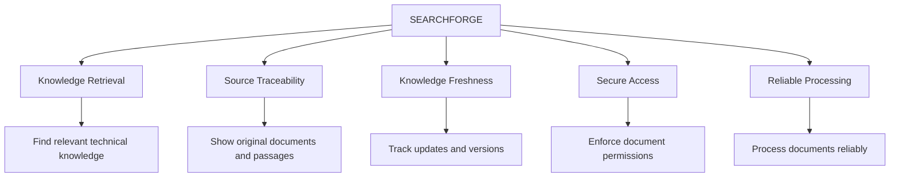

| Pillar | Purpose |
|---|---|
| Knowledge Retrieval | Find relevant technical information |
| Source Traceability | Show the original supporting sources |
| Knowledge Freshness | Track document updates and versions |
| Secure Access | Prevent unauthorized knowledge access |
| Reliable Processing | Handle background jobs and failures |

---

# 4. Target Users

## Primary users

- Backend developers.
- Frontend developers.
- DevOps engineers.
- Software architects.
- Technical leads.
- Engineering team members.

## Initial target organizations

Small and medium-sized software engineering teams.

This is an initial product hypothesis, not a validated customer segment.

## Supported knowledge categories

| Category | Example |
|---|---|
| Incident Reports | PostgreSQL connection timeout investigation |
| Troubleshooting Guides | Database connection pool configuration |
| API Documentation | REST API endpoint specifications |
| ADRs | Why PostgreSQL was selected |
| Engineering Documentation | Deployment and setup instructions |

---

# 5. Complete System at a Glance

SearchForge has two major workflows:

- Document ingestion and indexing.
- Knowledge retrieval and answer generation.

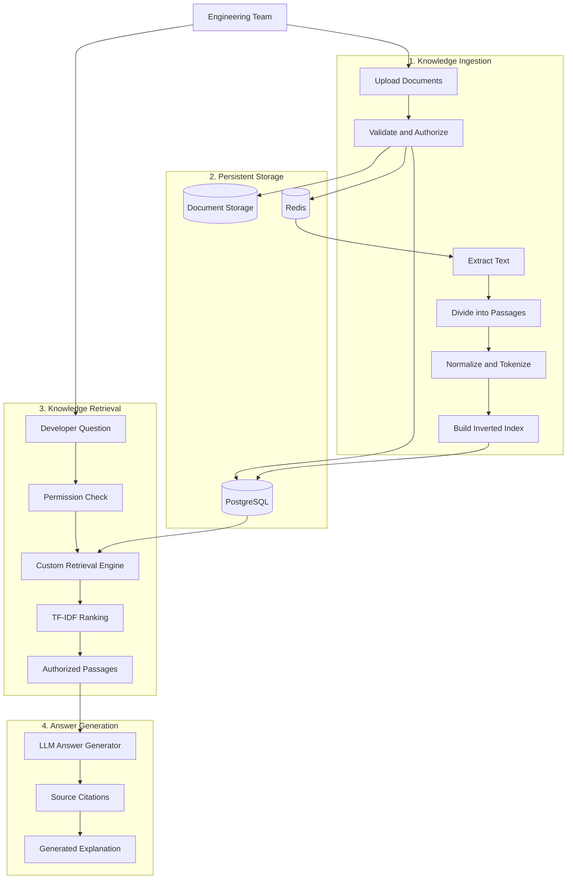

The custom retrieval engine and answer generation module are separate components.

**Important architectural principle:** SearchForge must still be able to retrieve documents even if the LLM provider becomes unavailable.

---

# 6. Workflow A — Document Ingestion and Indexing

This workflow explains how engineering knowledge enters SearchForge.

## Step-by-step process

### Step 1: Document upload

An authorized engineer uploads a technical document.

Examples:

- `Incident-104.pdf`
- `Database-Troubleshooting.md`
- `Payment-API-Documentation.pdf`
- `ADR-012.md`

### Step 2: Validation

The backend checks:

- User authentication.
- Organization membership.
- Upload authorization.
- File type.
- File size.
- Duplicate or conflicting document versions.

### Step 3: Document storage

The original file is stored securely.

PostgreSQL stores its metadata, ownership and permissions.

### Step 4: Background processing

The backend creates an indexing job using BullMQ and Redis.

The API does not need to wait for the entire extraction and indexing process.

### Step 5: Text extraction

A background worker extracts text from the uploaded document.

### Step 6: Passage segmentation

Extracted text is divided into meaningful sections or passages.

For example:

Original document:

```text
PostgreSQL Connection Troubleshooting

Section 1: Problem Description

The application experienced connection timeouts.

Section 2: Root Cause

The database connection pool reached its maximum capacity.

Section 3: Resolution

The team investigated long-running queries
and reviewed connection pool configuration.
```

Possible passages:

```text
Passage 1:
The application experienced connection timeouts.

Passage 2:
The database connection pool reached its maximum capacity.

Passage 3:
The team investigated long-running queries
and reviewed connection pool configuration.
```

### Step 7: Normalization and tokenization

Example:

```text
Original:
PostgreSQL connection pool exhausted.

Normalized:
postgresql connection pool exhausted

Tokens:
["postgresql", "connection", "pool", "exhausted"]
```

### Step 8: Inverted index creation

SearchForge creates a mapping between terms and the passages containing them.

Example:

| Term | Document / Passage |
|---|---|
| postgresql | Incident-104 / P1 |
| connection | Incident-104 / P1 |
| pool | Incident-104 / P1 |
| exhausted | Incident-104 / P1 |
| queries | Incident-104 / P3 |

The actual index will also maintain posting information such as term frequencies and document or passage references.

### Step 9: Index completion

After successful processing, the document status changes to `INDEXED`.

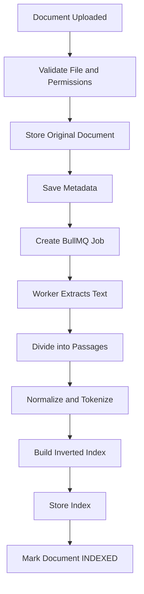

### Document processing statuses

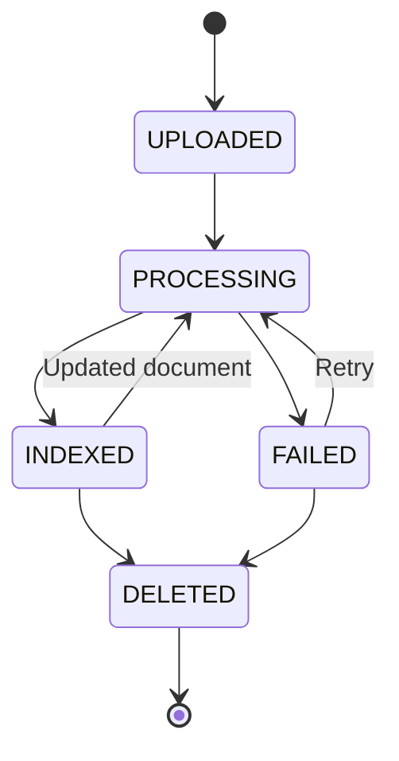

A document must not become searchable until its index is successfully available.

---

# 7. Why Do We Need an Inverted Index?

Suppose we have three documents:

| Document | Content |
|---|---|
| D1 | Node.js backend development |
| D2 | Java backend development |
| D3 | Node.js database optimization |

Without an index, the system may need to scan document contents for every search.

With an inverted index:

```text
nodejs       -> D1, D3
backend      -> D1, D2
development  -> D1, D2
java         -> D2
database     -> D3
optimization -> D3
```

The index maps:

**Term → Documents or passages containing that term.**

This allows SearchForge to identify candidate passages without repeatedly scanning every document.

## TF-IDF ranking

After candidate retrieval, SearchForge needs to rank results.

Initial formulas:

```text
TF(t,d) = Count of term t in document d
          --------------------------------
                Total terms in d
```

```text
IDF(t) = log(N / DF(t))
```

```text
TF-IDF(t,d) = TF(t,d) × IDF(t)
```

Where:

- `N` = Number of indexed documents.
- `DF(t)` = Number of documents containing term t.
- `TF(t,d)` = Frequency of term t in document d.

We will evaluate smoothed IDF and passage-level scoring during implementation.

TF-IDF is our initial ranking baseline, not a semantic understanding algorithm.

---

# 8. Workflow B — Knowledge Retrieval

Now suppose a developer searches:

> Why are PostgreSQL connections timing out, and how did we solve this previously?

SearchForge performs the following operations.

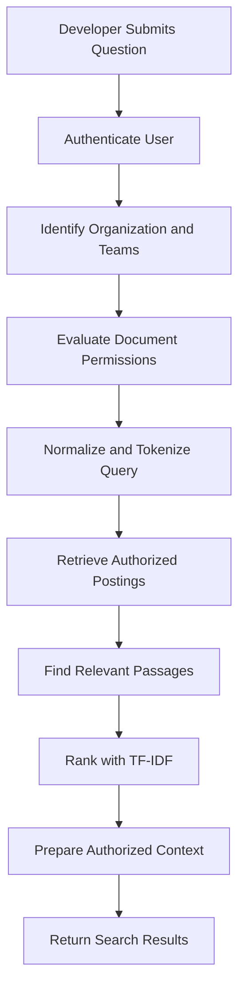

## Why permission checking matters

Suppose three engineers upload documents:

| Document | Owner | Visibility |
|---|---|---|
| Incident-104 | Rahul | ORGANIZATION |
| Database-Guide | Sara | TEAM |
| Internal-ADR | Aman | PRIVATE |

A developer in the backend team may access:

- Organization-wide documents.
- Authorized backend team documents.
- Their own private documents.

They must not access another employee's private documents.

**Authorization must happen in the backend before document content, passages, snippets or source references are exposed.**

---

# 9. Permission Model

SearchForge initially supports three visibility levels.

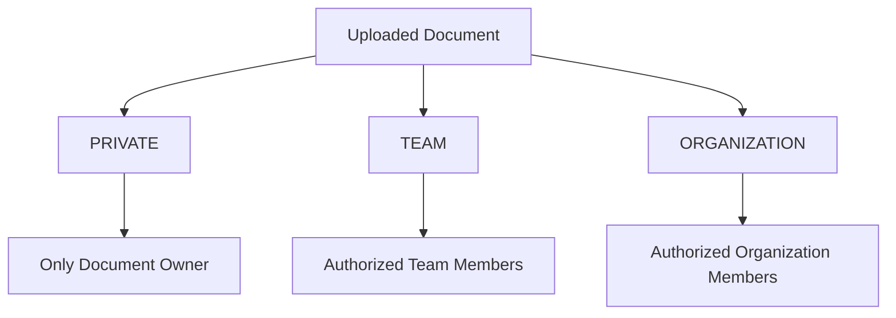

### PRIVATE

Only the document owner can access it.

### TEAM

Members of the selected team can access it.

### ORGANIZATION

Authorized members of the organization can access it.

Future enhancements may include explicitly sharing private documents with selected colleagues.

---

# 10. Workflow C — Context-Grounded Answer Generation

This is one of SearchForge's most important capabilities.

A traditional search engine returns documents.

SearchForge aims to retrieve the relevant passages and generate an understandable paragraph using those passages.

This approach is called:

**Retrieval-Augmented Generation (RAG).**

## Example

Developer question:

> Why are PostgreSQL connections timing out?

SearchForge retrieves two authorized sources.

### Source 1 — Incident-104.md

```text
Root Cause:

The PostgreSQL connection pool reached
its maximum capacity.
```

### Source 2 — Database-Troubleshooting.pdf

```text
Troubleshooting:

Inspect active database connections
and identify long-running queries.
```

### Generated answer

```text
The previous incident report indicates that
PostgreSQL connection timeouts occurred because
the connection pool reached its maximum capacity.

The troubleshooting guide recommends inspecting
active connections and identifying long-running
queries before changing connection pool settings.
```

The answer is generated from the retrieved passages.

## RAG architecture

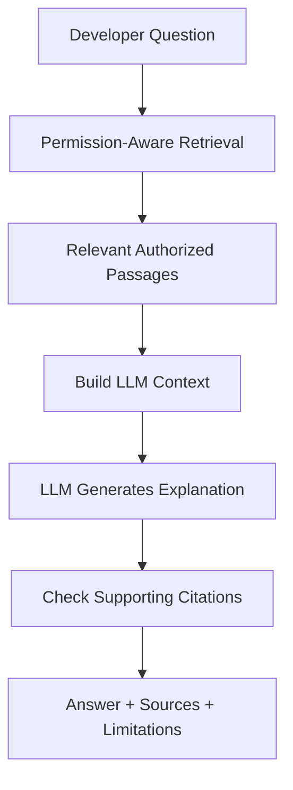

## Important generation rules

The LLM should:

- Use retrieved passages as evidence.
- Cite the original sources.
- Avoid inventing company-specific facts.
- Identify insufficient information.
- Preserve uncertainty.
- Avoid treating conflicting documents as one agreed-upon fact.

A citation must actually support the statement it accompanies.

---

# 11. Answer Generation Roadmap: Phase A → Phase B

We will develop answer generation in two phases.

## Phase A — Internal Documents Only

Initial release.

The LLM generates answers using only retrieved organizational documents.

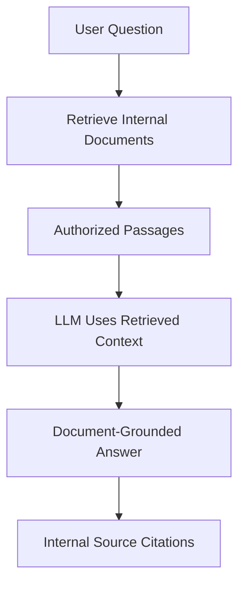

Expected behavior:

- Summarize internal documents.
- Combine information from multiple sources.
- Provide source citations.
- Say when information is insufficient.
- Avoid unsupported external technical claims.

## Phase B — Internal Knowledge + General Technical Knowledge

Future enhancement.

The LLM may add general technical explanations beyond the uploaded documents.

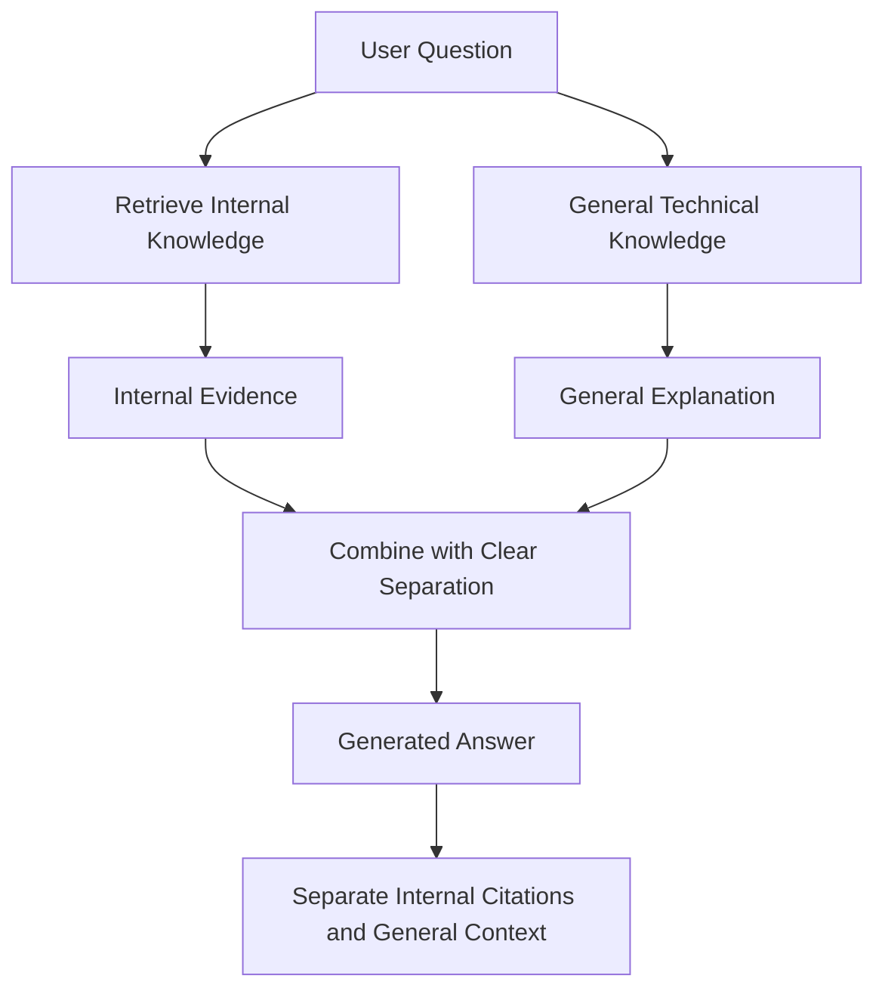

Example:

**Internal evidence:** The company's previous incident was caused by connection-pool exhaustion.

**General explanation:** A connection pool limits and reuses database connections to manage resource consumption.

**Recommendation:** Investigate actual connection usage and long-running queries before changing configuration.

SearchForge must distinguish company-specific evidence from general explanations.

---

# 12. Source Traceability

Every generated answer should allow users to inspect the original knowledge behind it.

Example:

```text
Generated Answer:
PostgreSQL timeouts occurred because the
connection pool reached maximum capacity.

Supporting Sources:

1. Incident-104.md
   Section: Root Cause and Resolution

2. Database-Troubleshooting.pdf
   Page: 4
   Section: Connection Pool Troubleshooting
```

## Why this matters

- Developers can verify the answer.
- They can read the original investigation.
- They can understand the surrounding context.
- They can identify conflicting information.
- They can avoid blindly trusting AI-generated explanations.

Source references should be stored during extraction and passage segmentation, not guessed by the LLM.

---

# 13. Knowledge Freshness and Versioning

Technical knowledge changes over time.

Suppose a troubleshooting guide is updated.

SearchForge should:

1. Detect the new document version.
2. Store update information.
3. Re-process the new content.
4. Replace the active index safely.
5. Preserve version history according to retention rules.
6. Show the latest update timestamp.

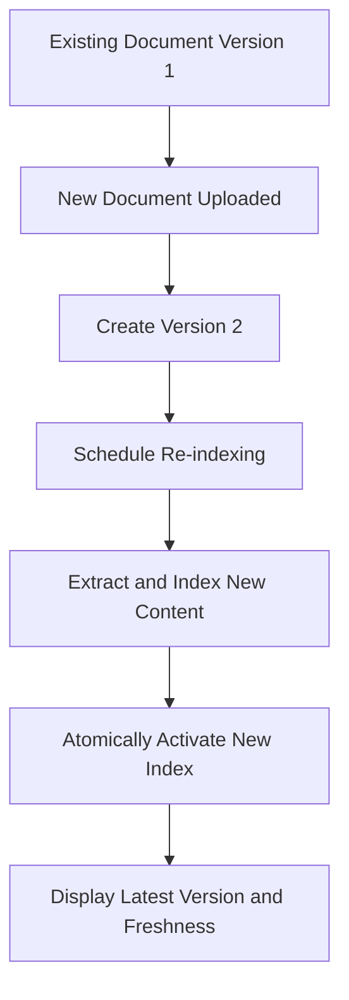

Example:

| Field | Value |
|---|---|
| Document | Incident-104.md |
| Current version | Version 2 |
| Previous version | Version 1 |
| Last updated | 12 November 2026 |
| Index status | INDEXED |

The date is illustrative.

Freshness indicators must not automatically imply that a recently updated document is factually correct. They indicate when it was updated, not whether its contents are still valid.

---

# 14. Reliable Background Processing

Why do we need Redis and BullMQ?

Imagine an engineer uploads a large PDF.

Text extraction and indexing may take time.

If the backend performs all processing synchronously, the request may take too long or time out.

Instead:

1. The API validates the upload.
2. The document is stored.
3. A background job is created.
4. The API responds with a processing status.
5. A worker processes the document independently.

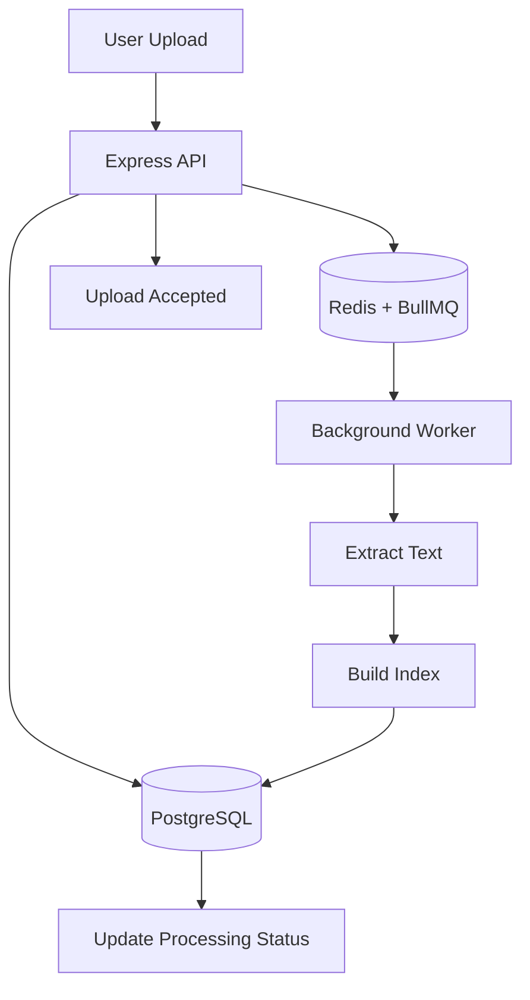

## Failure handling

What happens if a worker crashes?

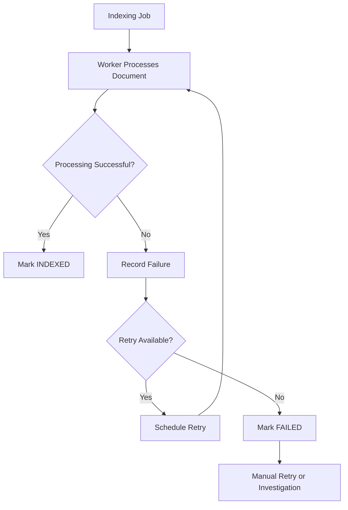

Important reliability concepts:

- Idempotency.
- Retry and exponential backoff.
- Duplicate-job protection.
- Atomic index replacement.
- Worker recovery.
- Failure tracking.
- Safe document deletion.

Redis is used for queue coordination. PostgreSQL remains the persistent source of truth.

---

# 15. Complete Technology Stack

| Component | Technology | Responsibility |
|---|---|---|
| Frontend | React + Vite | User interface |
| Backend | Node.js + Express | APIs and business logic |
| Language | JavaScript | Application development |
| Database | PostgreSQL | Persistent data |
| ORM | Prisma | Database access |
| Queue | BullMQ | Job management |
| Queue storage | Redis | Queue coordination |
| Search | Custom inverted index | Candidate retrieval |
| Ranking | TF-IDF | Relevance ranking |
| AI | LLM API | Grounded answer generation |
| Testing | Jest + Supertest | Automated tests |
| Deployment | Docker and cloud hosting | Reproducible deployment |

Technology choices will be reviewed during architecture research.

---

# 16. Proposed Database Entities

The following is an initial conceptual model, not a finalized Prisma schema.

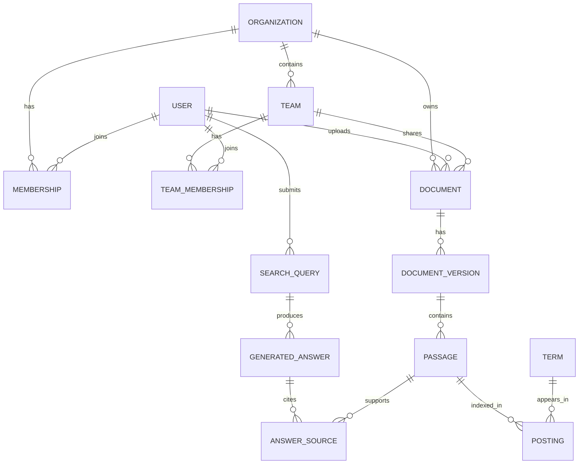

### Important entities

- User
- Organization
- Membership
- Team
- TeamMembership
- Document
- DocumentVersion
- Passage
- Term
- Posting
- SearchQuery
- GeneratedAnswer
- AnswerSource

The final schema will be designed after analyzing permissions, indexing consistency, versioning and retrieval requirements.

---

# 17. Initial MVP Scope

We will build a focused MVP rather than attempting to implement every enterprise feature.

| Area | Initial scope |
|---|---|
| Authentication | Registration and login |
| Organization | Organization and membership |
| Teams | Team membership |
| Documents | Manual uploads |
| Processing | Text extraction and segmentation |
| Indexing | Custom inverted index |
| Retrieval | Keyword search |
| Ranking | TF-IDF |
| Permissions | Private, team and organization |
| Freshness | Timestamps and basic versions |
| Reliability | BullMQ, retries and idempotency |
| Traceability | Passage and source references |
| Answer generation | RAG Phase A |

---

# 18. Out of Scope for the Initial MVP

We will not initially build:

- Slack integration.
- GitHub integration.
- Confluence integration.
- Automatic document crawling.
- OCR for scanned documents.
- Advanced semantic search.
- Hybrid vector and keyword retrieval.
- Cross-organization search.
- Complex enterprise administration.
- General-knowledge answer generation (Phase B).

These can be evaluated after the initial retrieval system works.

---

# 19. How Will We Measure Success?

A strong engineering project must be measurable.

## Retrieval quality

- Precision at K.
- Recall at K.
- Mean Reciprocal Rank.
- Relevance of retrieved passages.

## Answer quality

- Factual support.
- Citation correctness.
- Citation completeness.
- Unsupported claim rate.
- Correct handling of insufficient evidence.

## Performance

- Search latency.
- p95 latency.
- Indexing throughput.
- Index storage overhead.

## Reliability

- Job failure rate.
- Retry success rate.
- Worker recovery.
- Duplicate processing prevention.
- Index consistency.

## Security

- Organization isolation.
- Team-level permission tests.
- Private document protection.
- Unauthorized snippet prevention.
- Unauthorized source-reference prevention.

We will establish numeric targets after baseline experiments.

---

# 20. Product Validation Status

| Question | Current status |
|---|---|
| Does the knowledge retrieval problem exist? | Supported by secondary research |
| Do developers struggle with documentation discovery? | Supported by public evidence |
| Is there an underserved customer segment? | Not yet validated |
| Will teams adopt SearchForge? | Not yet validated |
| Will organizations pay for it? | Not yet validated |
| Does generated technical explanation provide value? | Requires prototype evaluation |

SearchForge is justified as an engineering MVP. Commercial viability remains an open question.

---

# 21. Development Roadmap

We will follow a research-first and incremental engineering workflow.

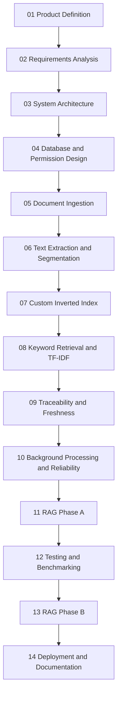

## Development principles

1. Understand each concept before implementation.
2. Research alternatives and trade-offs.
3. Document architecture decisions.
4. Implement incrementally.
5. Test each component.
6. Benchmark retrieval and performance.
7. Record limitations and engineering decisions.
8. Push meaningful work to GitHub.

The custom retrieval engine must remain independent of the LLM.

---

# 22. Final Product Definition

**SearchForge — Engineering Knowledge Retrieval & Answer Generation Platform**

SearchForge helps engineering teams discover and reuse organizational technical knowledge by combining custom retrieval infrastructure, permission-aware passage retrieval, source traceability, document freshness, reliable asynchronous indexing and context-grounded AI answer generation.

### Initial answer-generation scope

**Phase A:** Generate answers using internal organizational documents only.

### Future answer-generation scope

**Phase B:** Combine internal documents with clearly separated general technical knowledge.

### Core engineering principle

> Retrieve the correct, authorized and up-to-date knowledge before generating an answer.

### Next milestone

Functional requirements, non-functional requirements and acceptance criteria.

---

**Document status:** Product definition v2.1  

